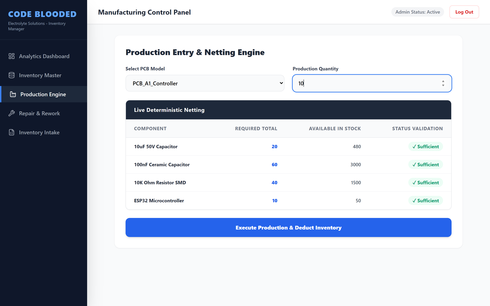
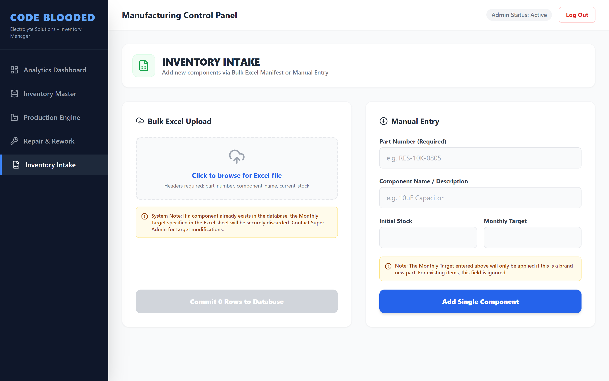
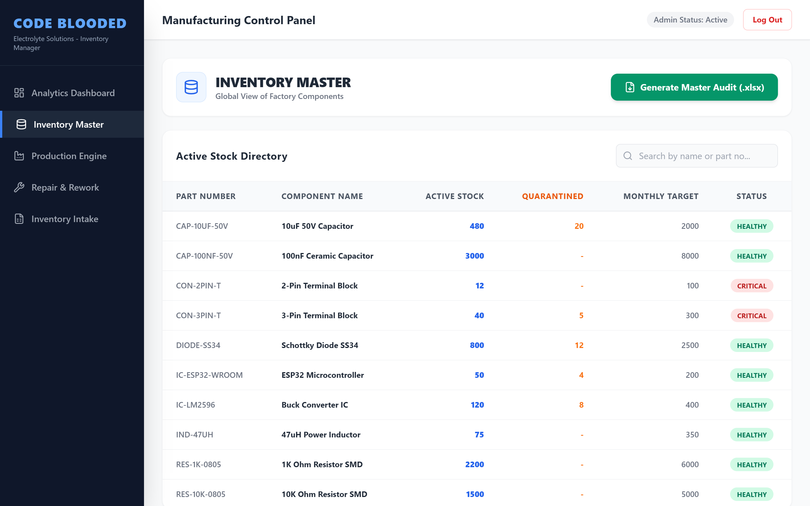
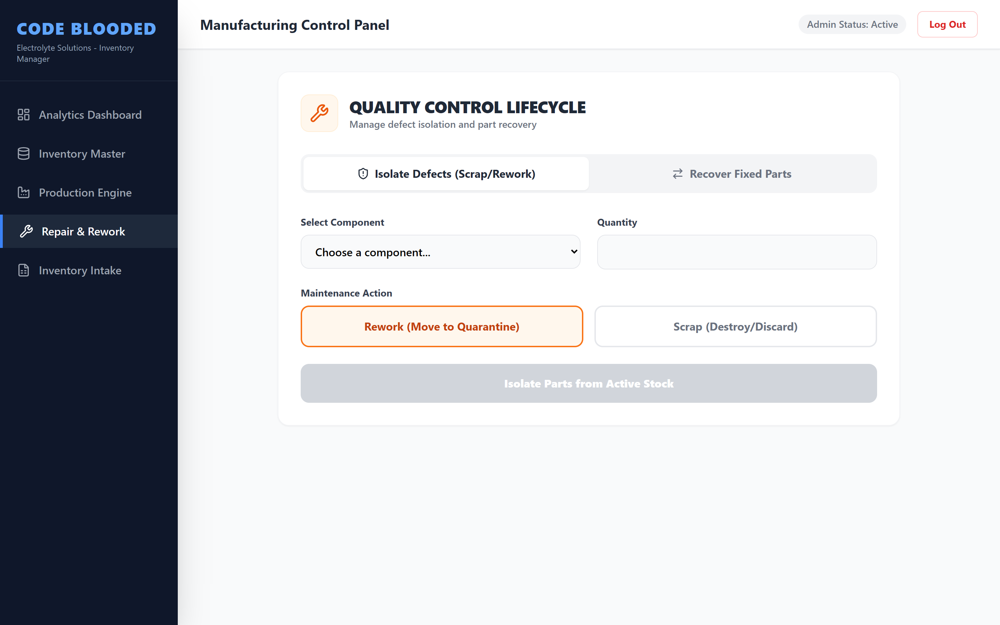
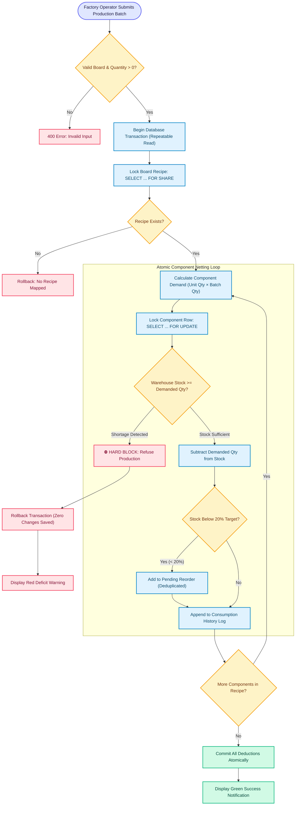
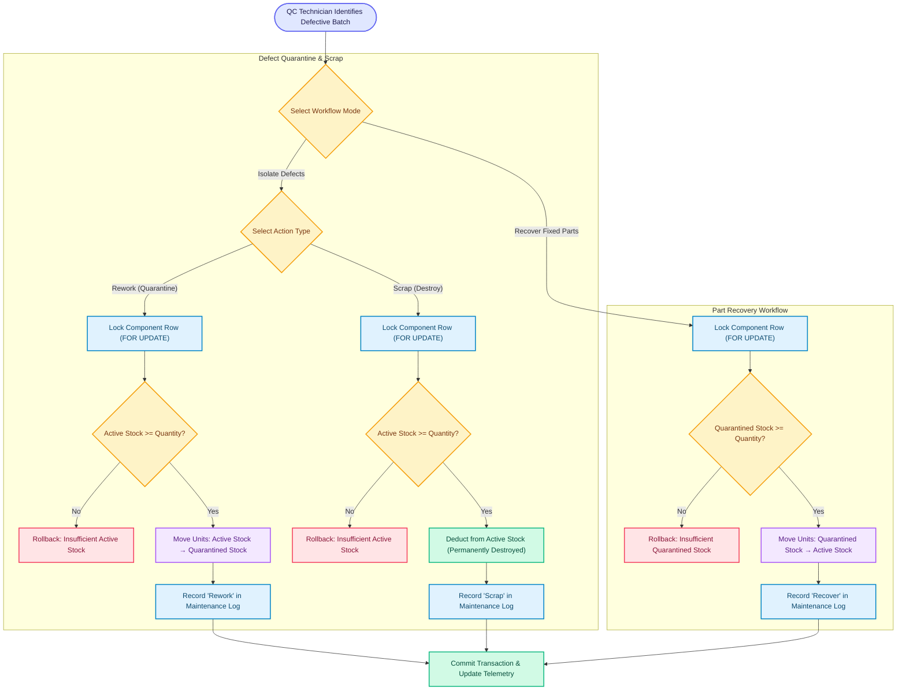
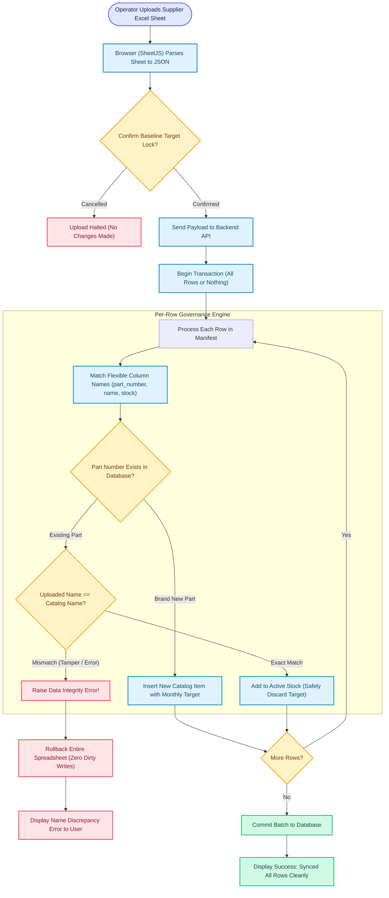

<div align="center">

# ⚡ Invictus '26 — Code_Blooded
### *Electrolyte Solutions: Smart Factory Inventory & Production Engine (MRP)*

[](https://www.postgresql.org/)
[](https://nodejs.org/)
[](https://expressjs.com/)
[](https://react.dev/)
[](https://vitejs.dev/)
[](https://tailwindcss.com/)
[](#-how-we-keep-factory-data-bulletproof-acid)
[](#-license)

<br/>

**A rock-solid manufacturing engine built to eliminate shop-floor inventory errors. Stops negative stock collisions, tracks broken parts through quarantine, triggers automatic reorders before stockouts, and protects master catalog data from corrupted spreadsheets.**

<br/>

<!-- ===================================================================== -->
<!--                       PRIMARY UI SHOWCASE                             -->
<!-- ===================================================================== -->

<table align="center" width="100%">
  <tr>
    <th width="50%" align="center">📊 Real-Time Analytics &amp; Factory Telemetry</th>
    <th width="50%" align="center">⚙️ Live Production Netting &amp; BOM Exploder</th>
  </tr>
  <tr>
    <td align="center" valign="middle">
      
      <br/><br/>
      <sub><b>Factory Command Center:</b> Watch live component consumption, track rework vs. scrap rates, and view instant red alerts when stock dips below 20%.</sub>
    </td>
    <td align="center" valign="middle">
      
      <br/><br/>
      <sub><b>Smart Production Engine:</b> Select a circuit board model and batch size. The engine checks live warehouse stock and blocks production if even one part is missing.</sub>
    </td>
  </tr>
</table>

<br/>

<table align="center" width="100%">
  <tr>
    <th width="33%" align="center">📥 Bulk Excel &amp; Manual Intake</th>
    <th width="33%" align="center">🗄️ Master Inventory &amp; Audit</th>
    <th width="33%" align="center">🛡️ Quality Control &amp; Quarantine</th>
  </tr>
  <tr>
    <td align="center" valign="middle">
      
      <br/><br/>
      <sub><b>Safe Ingestion:</b> Drag and drop supplier Excel sheets. Protects monthly targets and blocks uploads if part names don't match.</sub>
    </td>
    <td align="center" valign="middle">
      
      <br/><br/>
      <sub><b>Stock Directory:</b> Instant search across all active and quarantined components. Generates a 3-tab audit workbook (.xlsx) with one click.</sub>
    </td>
    <td align="center" valign="middle">
      
      <br/><br/>
      <sub><b>Defect Lifecycle:</b> Safely move damaged parts into Quarantine (Rework), discard broken parts (Scrap), or return fixed parts to active stock.</sub>
    </td>
  </tr>
</table>

<br/>

[The Real Factory Problem](#-the-real-factory-problem--how-we-solve-it) • [The 4 Superpowers](#-the-4-superpowers-of-this-engine) • [Interactive Flowcharts](#-system-execution-flowcharts) • [Built-in Boards &amp; Components](#-built-in-circuit-boards--components) • [5-Minute Quick Start](#-5-minute-quick-start-guide) • [Interactive Testing Playbook](#-interactive-testing-playbook)

</div>

---

## 🏭 The Real Factory Problem & How We Solve It

In high-speed electronics assembly, machines build hundreds of circuit boards every hour. Standard inventory spreadsheets and basic web apps fail constantly because factory operations are fast, concurrent, and unpredictable:

| Everyday Factory Vulnerability | The Expensive Consequence | The Code_Blooded Guarantee |
| :--- | :--- | :--- |
| **Two operators build boards at the same time** | Both hit "Produce" simultaneously. Stock gets deducted twice, sending inventory into impossible negative numbers. | **Row-Level Locking (`FOR UPDATE`):** Locks each component row during deduction so concurrent runs wait safely in line. |
| **Missing just one tiny capacitor** | The assembly line starts, builds half a board, and stops dead when a 10-cent component is missing. | **The Hard Block Rule:** The engine checks every single part before deducting anything. If even one part is short, the run aborts cleanly. |
| **Damaged components vanish off the books** | A technician finds 5 bent pins, tosses them into a bin, and active stock numbers become completely inaccurate. | **3-State Quarantine:** Parts move cleanly between **Active**, **Quarantine (Rework)**, and **Scrapped (Destroyed)** with full audit trails. |
| **Suppliers send messy Excel sheets** | An operator uploads an Excel file with mismatched part codes, corrupting baseline monthly targets. | **Zero-Trust Intake:** Smart header matching, catalog identity verification, and strict baseline target protection. |

---

## ⚡ The 4 Superpowers of This Engine

<table width="100%">
  <tr>
    <td width="25%" valign="top">
      <h4>🔒 1. All-or-Nothing Netting</h4>
      <ul>
        <li>Reads exact Bill of Materials (BOM) recipe</li>
        <li>Row-level pessimistic locking prevents race conditions</li>
        <li>Zero negative stock: all parts deduct together or none at all</li>
      </ul>
    </td>
    <td width="25%" valign="top">
      <h4>⚡ 2. 20% Auto-Reorder</h4>
      <ul>
        <li>Database trigger watches stock continuously</li>
        <li>Instant alert the millisecond stock drops below 20%</li>
        <li>Smart index blocks duplicate alert spam</li>
      </ul>
    </td>
    <td width="25%" valign="top">
      <h4>🛡️ 3. Closed-Loop QC</h4>
      <ul>
        <li>Isolate defects safely into Quarantine</li>
        <li>Permanently destroy unfixable parts via Scrap</li>
        <li>Recover repaired parts back to active production</li>
      </ul>
    </td>
    <td width="25%" valign="top">
      <h4>📥 4. Zero-Trust Intake</h4>
      <ul>
        <li>In-browser Excel parsing via SheetJS</li>
        <li>Auto-matches column names like qty, count, part_no</li>
        <li>Cancels batch if component name doesn't match catalog</li>
      </ul>
    </td>
  </tr>
</table>

---

## 📊 System Execution Flowcharts

Every critical manufacturing workflow in the engine is mapped below. Click any section to inspect the logic.

<details>
<summary><b>▶ ⚙️ Flowchart 1: Production Engine &amp; Atomic BOM Netting (Click to Expand)</b></summary>
<br/>



</details>

<br/>

<details>
<summary><b>▶ 🛡️ Flowchart 2: Quality Control &amp; Quarantine Lifecycle (Click to Expand)</b></summary>
<br/>



</details>

<br/>

<details>
<summary><b>▶ 📥 Flowchart 3: Strict Bulk Excel Intake &amp; Data Governance (Click to Expand)</b></summary>
<br/>



</details>

---

## 🧩 Built-in Circuit Boards & Components

All factory models and parts are pre-seeded in [`database_setup.sql`](file:///c:/Users/parth/Desktop/ReadMe/Code_Blooded-Invictus26/database_setup.sql):

### 1. Circuit Board Recipes (Bill of Materials)

| PCB Model Name | Required Components per Unit |
| :--- | :--- |
| **`PCB_A1_Controller`** | 2x 10uF Capacitor, 6x 100nF Ceramic Cap, 4x 10K Resistor, 1x ESP32 Microcontroller |
| **`PCB_B7_LED_Driver`** | 1x 10uF Capacitor, 3x 1K Resistor, 1x Buck Converter IC, 2x Schottky Diode SS34 |
| **`PCB_C3_Power_Module`** | 3x 10uF Capacitor, 2x Buck Converter IC, 1x 47uH Power Inductor, 2x Schottky Diode SS34 |
| **`PCB_D4_WiFi_Interface`** | 5x 100nF Ceramic Cap, 6x 10K Resistor, 1x ESP32 Microcontroller, 1x 3-Pin Terminal Block |

### 2. Factory Warehouse Catalog

| Part Number | Component Description | Initial Stock | Monthly Target | Factory Health |
| :--- | :--- | :---: | :---: | :---: |
| `CAP-10UF-50V` | 10uF 50V Capacitor | 500 | 2000 | Healthy |
| `CAP-100NF-50V` | 100nF Ceramic Capacitor | 3000 | 8000 | Healthy |
| `RES-10K-0805` | 10K Ohm Resistor SMD | 1500 | 5000 | Healthy |
| `RES-1K-0805` | 1K Ohm Resistor SMD | 2200 | 6000 | Healthy |
| `IC-ESP32-WROOM` | ESP32 Microcontroller | 50 | 200 | Healthy |
| `IC-LM2596` | Buck Converter IC | 120 | 400 | Healthy |
| `DIODE-SS34` | Schottky Diode SS34 | 800 | 2500 | Healthy |
| `CON-2PIN-T` | 2-Pin Terminal Block | **12** | 100 | ⚠️ **Critical (< 20%)** |
| `CON-3PIN-T` | 3-Pin Terminal Block | **40** | 300 | ⚠️ **Critical (< 20%)** |
| `IND-47UH` | 47uH Power Inductor | 75 | 350 | Healthy |

---

## 🔒 How We Keep Factory Data Bulletproof (ACID)

| Principle | Implementation in Code_Blooded |
| :--- | :--- |
| **Atomicity** | All BOM components are deducted in a single atomic transaction. Any stock deficit immediately triggers `ROLLBACK`. |
| **Consistency** | Database-level `CHECK (current_stock >= 0)` constraints make negative stock mathematically impossible. |
| **Isolation** | `REPEATABLE READ` transaction isolation and `FOR UPDATE` row locks prevent simultaneous runs from interfering. |
| **Durability** | PostgreSQL Write-Ahead Logging (WAL) ensures every consumption log and audit record survives power failures. |

---

## 🚀 5-Minute Quick Start Guide

Follow these steps to launch the entire factory simulation locally:

### 📋 Prerequisites
- **Node.js** (v18.0.0 or higher)
- **PostgreSQL** (v14 or higher)
- **Git**

---

### Step 1: Initialize Database
```bash
# 1. Create database in PostgreSQL
createdb invictus_inventory

# 2. Run the initialization script
psql -U postgres -d invictus_inventory -f database_setup.sql
```

---

### Step 2: Start Backend Server
```bash
cd backend
npm install
cp .env.example .env

# Edit .env with your local PostgreSQL password, then run:
npm run dev
```
*Backend runs on:* `http://localhost:5000`

---

### Step 3: Start Frontend Application
```bash
cd ../frontend
npm install
npm run dev
```
*Open your browser at:* 👉 **`http://localhost:5173`**

---

### 🔑 Default Credentials

> [!NOTE]
> The database script automatically injects the administrator account:
> - **Username:** `admin`
> - **Password:** `admin123`
> - **Role:** `Admin`

---

## 🏆 Interactive Testing Playbook

A fast 2-minute walkthrough to test the engine's core capabilities:

1. **Test Production Netting (Happy Path):**  
   Navigate to **Production Engine**, pick `PCB_A1_Controller`, enter quantity `10`. All status badges show green `✓ Sufficient`. Click **Execute Production** — all components deduct atomically.

2. **Test Zero-Deficit Hard Block:**  
   Pick `PCB_D4_WiFi_Interface` and enter quantity `50` (demanding 50 units of `CON-3PIN-T`, but only 40 exist). The engine detects the shortage immediately, highlights the row in red, and locks the button: `⛔ HARD BLOCK: Insufficient Stock`.

3. **Test Quality Control & Part Recovery:**  
   Go to **Repair & Rework**. Under *Isolate Defects*, move 15 units of `CAP-10UF-50V` into *Rework (Quarantine)*. Switch to *Recover Fixed Parts* to return 10 units back into active stock. Check the **Analytics Dashboard** to see the live QC donut chart update!

4. **Test Spreadsheet Safety & Audit Export:**  
   Go to **Inventory Intake** and upload an Excel row with a mismatched component name — the system detects the discrepancy and halts the upload with zero dirty writes. Head to **Inventory Master** and click **Generate Master Audit (.xlsx)** to download a complete 3-tab ISO compliance report.

---

## 📁 Repository Directory Structure

```
Code_Blooded-Invictus26/
├── backend/
│   ├── src/
│   │   ├── config/
│   │   │   └── db.js                 # PostgreSQL connection pool with error listener
│   │   ├── controllers/
│   │   │   ├── authController.js      # JWT authentication and user validation
│   │   │   ├── inventoryController.js # Bulk Excel intake, QC lifecycle, and audit telemetry
│   │   │   └── productionController.js# Deterministic ACID netting engine with FOR UPDATE locks
│   │   ├── middleware/
│   │   │   ├── auth.js               # Bearer token verification middleware
│   │   │   └── upload.js             # In-memory file buffer handling
│   │   ├── routes/
│   │   │   ├── auth.routes.js        # Auth endpoint definitions
│   │   │   ├── inventory.routes.js   # Inventory endpoint definitions
│   │   │   └── production.routes.js  # Secured production engine routes
│   │   └── server.js                 # Express server bootstrap, middleware, and route mounting
│   ├── .env.example                  # Environment configuration template
│   ├── package.json                  # Backend dependencies and scripts
│   └── package-lock.json
├── frontend/
│   ├── public/
│   │   └── vite.svg
│   ├── src/
│   │   ├── components/
│   │   │   ├── Header.jsx            # Manufacturing Control Panel header with logout action
│   │   │   └── Sidebar.jsx           # Industrial navigation sidebar with active route state
│   │   ├── pages/
│   │   │   ├── Dashboard.jsx         # Live telemetry, Recharts bar/pie charts, and QC modal
│   │   │   ├── Intake.jsx            # Drag-and-drop Excel upload and manual component entry
│   │   │   ├── InventoryMaster.jsx   # Searchable stock catalog and 3-sheet XLSX audit generator
│   │   │   ├── Login.jsx             # Secure administrative access portal
│   │   │   ├── Production.jsx        # Live BOM netting table with shortage detector & hard block
│   │   │   └── Repair.jsx            # Dual-mode defect isolation (rework/scrap) and recovery
│   │   ├── services/
│   │   │   └── api.js                # Axios client with JWT interceptor and 8000ms fail-safe timeout
│   │   ├── App.jsx                   # React Router v7 configuration with ProtectedRoute guards
│   │   ├── index.css                 # Tailwind CSS utility imports
│   │   └── main.jsx                  # React 19 root render in React.StrictMode
│   ├── package.json                  # Frontend dependencies and scripts
│   ├── tailwind.config.js            # Tailwind typography and theme configurations
│   └── vite.config.js                # Vite development server configuration
├── docs/
│   └── assets/                       # High-resolution production UI previews
│       ├── dashboard_preview.png     # Analytics dashboard with live Recharts telemetry
│       ├── production_preview.png    # Production netting engine with live BOM explosion
│       ├── inventory_preview.png     # Master inventory directory & multi-sheet audit generator
│       ├── intake_preview.png        # Bulk Excel drag-and-drop & manual intake hub
│       ├── repair_preview.png        # Quality control & defect quarantine lifecycle
│       └── login_preview.png        # Authentication access portal
├── database_setup.sql                # Complete schema DDL, triggers, indexes, and seed dataset
├── .gitignore
├── .gitattributes
└── README.md                         # Enterprise documentation
```

---

## 👥 The Team: Code_Blooded

Developed for the **Invictus 2026 Hackathon** by **Team Code_Blooded**:
- **Engineering Lead & Architecture:** [Parth Chavan](https://github.com/Parth-Chavan-15)

---

## 📄 License

This project is licensed under the **ISC License**. See `package.json` for details.  
All factory models, database triggers, and netting engines were engineered specifically for the Invictus '26 hackathon challenge.
