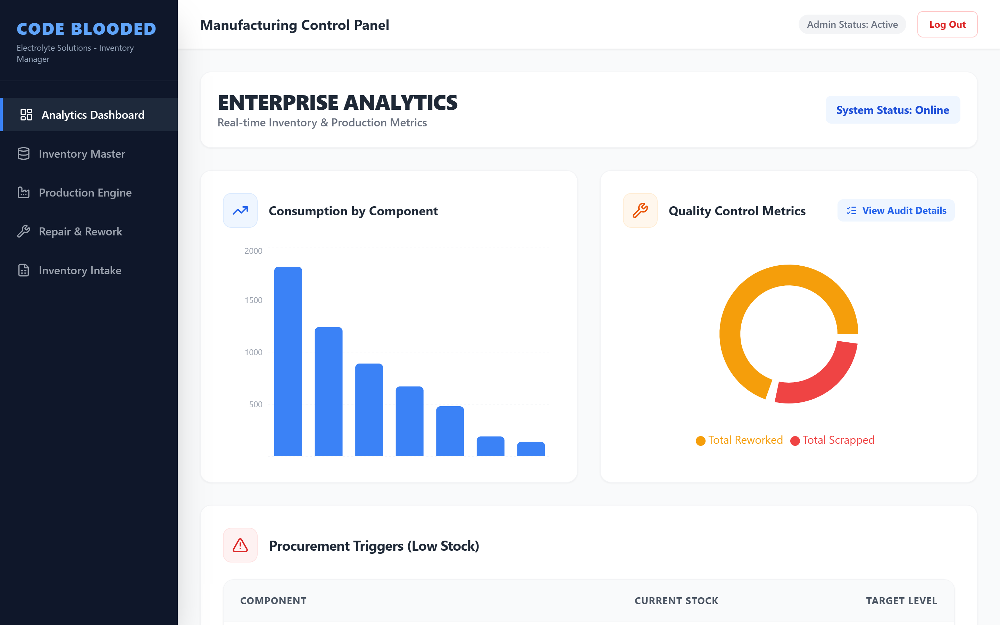
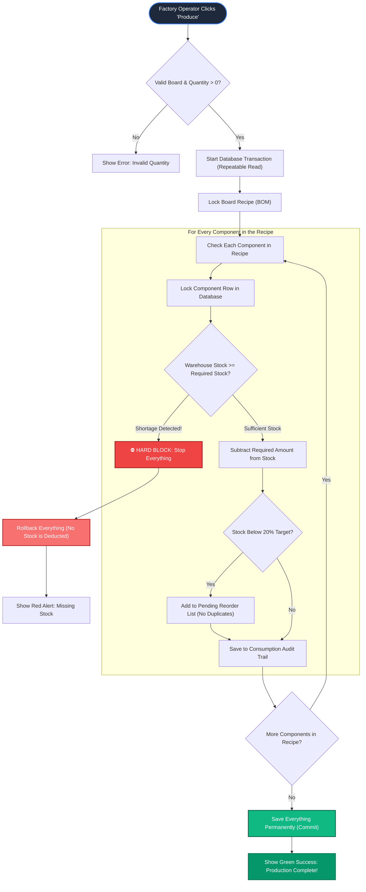
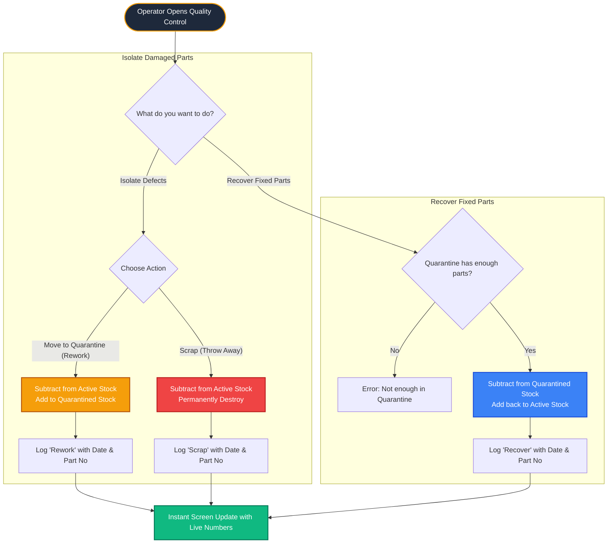
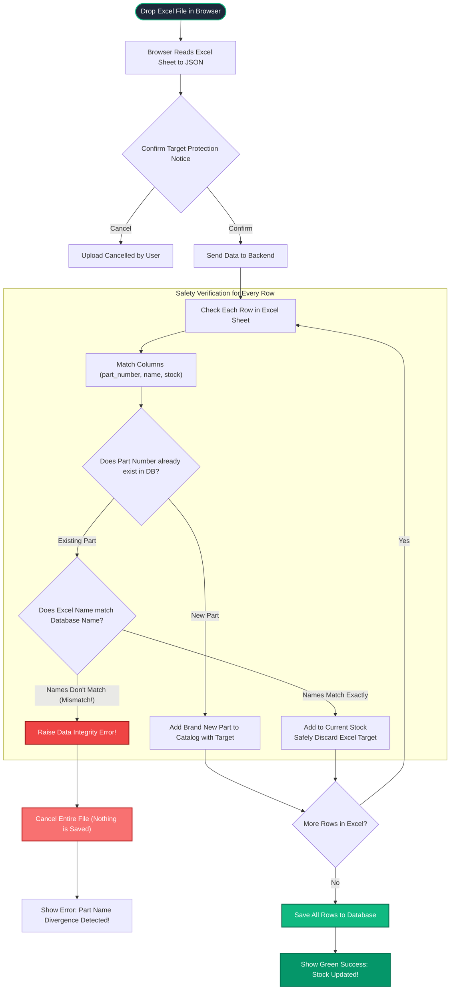
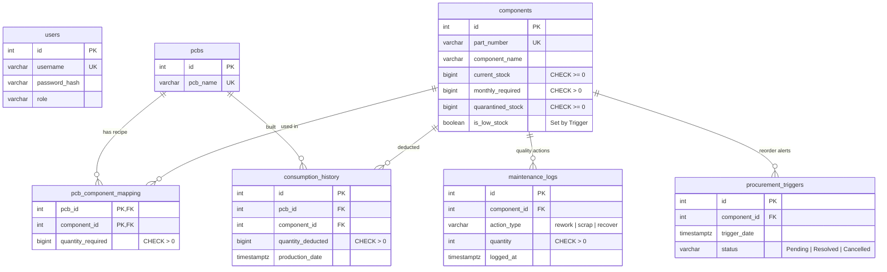

<div align="center">

# ⚡ Invictus '26 — Code_Blooded
### *Electrolyte Solutions: Smart Factory Inventory & Production Engine (MRP)*

[](https://www.postgresql.org/)
[](https://nodejs.org/)
[](https://expressjs.com/)
[](https://react.dev/)
[](https://vitejs.dev/)
[](https://tailwindcss.com/)
[](#-how-we-keep-factory-data-bulletproof-acid)
[](#-license)

<br/>

**A rock-solid manufacturing engine built to stop factory stock errors before they happen. Eliminates negative inventory, handles broken parts safely, warns you before parts run out, and stops bad spreadsheets from messing up your database.**

<br/>

<!-- ===================================================================== -->
<!--                       PRIMARY UI SHOWCASE                             -->
<!-- ===================================================================== -->

<table align="center" width="100%">
  <tr>
    <th width="50%" align="center">📊 Real-Time Analytics &amp; Factory Telemetry</th>
    <th width="50%" align="center">⚙️ Live Production Netting &amp; BOM Exploder</th>
  </tr>
  <tr>
    <td align="center" valign="middle">
      
      <br/><br/>
      <sub><b>Factory Command Center:</b> Watch live part consumption, track rework vs. scrap rates, and view instant red alerts when stock drops below 20%.</sub>
    </td>
    <td align="center" valign="middle">
      
      <br/><br/>
      <sub><b>Smart Production Engine:</b> Pick a circuit board model and quantity. The engine automatically checks warehouse stock and blocks production if even one part is missing.</sub>
    </td>
  </tr>
</table>

<br/>

<table align="center" width="100%">
  <tr>
    <th width="33%" align="center">📥 Bulk Excel &amp; Manual Intake</th>
    <th width="33%" align="center">🗄️ Master Inventory &amp; Audit</th>
    <th width="33%" align="center">🛡️ Quality Control &amp; Quarantine</th>
  </tr>
  <tr>
    <td align="center" valign="middle">
      
      <br/><br/>
      <sub><b>Safe Ingestion:</b> Drag and drop supplier Excel sheets. Protects monthly targets and blocks uploads if part names don't match.</sub>
    </td>
    <td align="center" valign="middle">
      
      <br/><br/>
      <sub><b>Stock Directory:</b> Instant search across all active and quarantined components. Generates a 3-tab audit workbook (.xlsx) with one click.</sub>
    </td>
    <td align="center" valign="middle">
      
      <br/><br/>
      <sub><b>Defect Lifecycle:</b> Safely move damaged parts into Quarantine (Rework), throw away broken parts (Scrap), or return fixed parts to active stock.</sub>
    </td>
  </tr>
</table>

<br/>

[The Real Factory Problem](#-the-real-factory-problem--how-we-solve-it) • [The 4 Superpowers](#-the-4-superpowers-of-this-engine) • [Simple Step-by-Step Flowcharts](#-simple-step-by-step-flowcharts) • [Built-in Boards & Components](#-built-in-circuit-boards--components) • [5-Minute Quick Start](#-5-minute-quick-start-guide) • [Try It Yourself (Judge's Walkthrough)](#-try-it-yourself-judges-walkthrough)

</div>

---

## 🏭 The Real Factory Problem & How We Solve It

In a fast-moving electronics factory, machines assemble hundreds of circuit boards every hour. Normal inventory software fails constantly because real factory floors are messy:

| What Usually Goes Wrong in Factories | Why It Causes Chaos | How Code_Blooded Fixes It |
| :--- | :--- | :--- |
| **Two operators build boards at the same time** | Both click "Produce" at the same second. The system deducts stock twice, creating impossible negative stock. | **Row-Level Locking:** Locks the database row for each part while deducting. No two people can fight over the same stock. |
| **Missing just one tiny capacitor** | The assembly line starts, builds half a board, and stops dead when a 10-cent resistor is missing. | **The Hard Block Rule:** Before any parts are deducted, the engine checks every single piece. If even 1 piece is short, it refuses to start. |
| **Damaged components vanish off the books** | A technician finds 5 bent pins, tosses them into a bin, and active stock numbers become completely inaccurate. | **3-State Quarantine:** Parts move cleanly between **Active**, **Quarantine (Rework)**, and **Scrapped (Destroyed)**. |
| **Suppliers send messy Excel sheets** | An operator uploads an Excel file with the wrong column names, overwriting carefully planned monthly targets. | **Zero-Trust Intake:** Smart header matching, checks that part names match what's already saved, and protects targets from being overwritten. |

---

## ⚡ The 4 Superpowers of This Engine

```
┌────────────────────────────────────────────────────────────────────────────────────────┐
│                          HOW CODE_BLOODED PROTECTS YOUR FACTORY                        │
├──────────────────────────┬───────────────────────────┬─────────────────────────────────┤
│    1. BULLETPROOF NETTING│   2. 20% AUTO-REORDER     │     3. SMART SPREADSHEET INTAKE │
│  • Checks every component│  • Database trigger warns │   • Reads any Excel column name │
│  • Locks rows during work│    you automatically      │   • Blocks renamed part errors  │
│  • Zero negative stock   │  • Stops duplicate alerts │   • Keeps monthly targets safe  │
│  • Everything or nothing │  • No manual counting     │   • Instant preview table       │
└──────────────────────────┴───────────────────────────┴─────────────────────────────────┘
```

### 1. The "All-or-Nothing" Production Engine
Every printed circuit board (PCB) needs a specific recipe of parts (called a Bill of Materials, or **BOM**). When you tell the engine to build 10 boards:
1. It looks up the exact recipe and locks it so nobody changes it mid-run.
2. It locks the inventory rows for each required component.
3. It multiplies each required part by 10 and compares it to live warehouse shelves.
4. If **every** part is available: it subtracts them all together in one atomic step and logs an audit trail.
5. If **even one part is short**: it cancels the entire run immediately. Zero partial deductions. Zero negative stock.

### 2. Autonomous 20% Reorder Sentinel
Nobody has time to check stock tables all day. In our PostgreSQL database, a smart trigger runs automatically whenever stock changes:
- It checks: `Is Current Stock < 20% of the Monthly Target?`
- The instant stock dips under 20%, the system flags it as **Low Stock (Critical)**.
- A special database rule ensures that you only get **one pending alert** per part, stopping annoying duplicate notification spam.

### 3. Closed-Loop Defect Quarantine (Rework & Scrap)
When parts arrive damaged or fail testing, you don't just delete them:
- **Rework (Quarantine):** Moves parts out of active stock and holds them safely in quarantine so production doesn't accidentally count them.
- **Scrap:** If a component is completely broken, you scrap it. It is permanently subtracted and logged in the maintenance audit.
- **Recover:** Once an engineer fixes quarantined parts, they click "Recover" to return them safely into active production stock.

### 4. Zero-Trust Excel Uploads
Suppliers love sending spreadsheets with different column headers (`qty`, `count`, `quantity`, `part code`, `item code`).
- **Flexible Header Matching:** The system automatically understands common column variations.
- **Name Verification Check:** If someone tries to upload part number `CAP-10UF-50V` with the name `Resistor`, the system catches the mismatch, stops the upload immediately, and makes zero changes.
- **Target Protection:** Incoming stock quantities are added, but your engineered monthly targets stay safe and locked.

---

## 📊 Simple, Step-by-Step Flowcharts

<details open>
<summary><b>1. ⚙️ How Production Checks Stock &amp; Deducts Parts (Click to Expand)</b></summary>
<br/>



</details>

---

<details open>
<summary><b>2. 🛡️ Quality Control: Handling Damaged &amp; Fixed Parts (Click to Expand)</b></summary>
<br/>



</details>

---

<details open>
<summary><b>3. 📥 How Excel Manifests Are Safely Uploaded (Click to Expand)</b></summary>
<br/>



</details>

---

## 🧩 Built-in Circuit Boards & Components

Everything in this project is seeded directly from real-world electronics manufacturing in [`database_setup.sql`](file:///c:/Users/parth/Desktop/ReadMe/Code_Blooded-Invictus26/database_setup.sql):

### 1. Built-in Circuit Boards (Recipes)

| PCB Model Name | What It Needs to Build 1 Unit (Bill of Materials) |
| :--- | :--- |
| **`PCB_A1_Controller`** | 2x 10uF Capacitor, 6x 100nF Ceramic Cap, 4x 10K Resistor, 1x ESP32 Microcontroller |
| **`PCB_B7_LED_Driver`** | 1x 10uF Capacitor, 3x 1K Resistor, 1x Buck Converter IC, 2x Schottky Diode SS34 |
| **`PCB_C3_Power_Module`** | 3x 10uF Capacitor, 2x Buck Converter IC, 1x 47uH Power Inductor, 2x Schottky Diode SS34 |
| **`PCB_D4_WiFi_Interface`** | 5x 100nF Ceramic Cap, 6x 10K Resistor, 1x ESP32 Microcontroller, 1x 3-Pin Terminal Block |

### 2. Built-in Warehouse Components

| Part Number | Component Description | Initial Stock | Monthly Target | Starting Status |
| :--- | :--- | :---: | :---: | :---: |
| `CAP-10UF-50V` | 10uF 50V Capacitor | 500 | 2000 | Healthy |
| `CAP-100NF-50V` | 100nF Ceramic Capacitor | 3000 | 8000 | Healthy |
| `RES-10K-0805` | 10K Ohm Resistor SMD | 1500 | 5000 | Healthy |
| `RES-1K-0805` | 1K Ohm Resistor SMD | 2200 | 6000 | Healthy |
| `IC-ESP32-WROOM` | ESP32 Microcontroller | 50 | 200 | Healthy |
| `IC-LM2596` | Buck Converter IC | 120 | 400 | Healthy |
| `DIODE-SS34` | Schottky Diode SS34 | 800 | 2500 | Healthy |
| `CON-2PIN-T` | 2-Pin Terminal Block | **12** | 100 | ⚠️ **Critical (< 20%)** |
| `CON-3PIN-T` | 3-Pin Terminal Block | **40** | 300 | ⚠️ **Critical (< 20%)** |
| `IND-47UH` | 47uH Power Inductor | 75 | 350 | Healthy |

---

## 🗄️ Database Architecture (Relational Model)

The database runs on PostgreSQL 14+ with strict rules to make sure no invalid data ever enters the system:



---

## 🔒 How We Keep Factory Data Bulletproof (ACID)

```
┌────────────────────────────────────────────────────────────────────────────────────────┐
│                        ACID TRANSACTION SAFETY GUARANTEES                              │
├─────────────────┬──────────────────────────────────────────────────────────────────────┤
│ Atomicity       │ All required parts are deducted together or none at all. If one part │
│                 │ is missing, the entire transaction rolls back cleanly.               │
├─────────────────┼──────────────────────────────────────────────────────────────────────┤
│ Consistency     │ Strict database rules (stock >= 0) and trigger recalculations        │
│                 │ guarantee that negative numbers are physically impossible.           │
├─────────────────┼──────────────────────────────────────────────────────────────────────┤
│ Isolation       │ Repeatable Read isolation and row-level locks (FOR UPDATE) stop two  │
│                 │ operators from fighting over the same parts simultaneously.          │
├─────────────────┼──────────────────────────────────────────────────────────────────────┤
│ Durability      │ Every consumption record and quality log is written to PostgreSQL's  │
│                 │ Write-Ahead Log (WAL) so no data is lost even during power cuts.     │
└─────────────────┴──────────────────────────────────────────────────────────────────────┘
```

---

## 🚀 5-Minute Quick Start Guide

Get the complete factory system up and running on your local machine in three simple steps.

### 📋 Prerequisites
- **Node.js** (v18.0.0 or higher recommended)
- **PostgreSQL** (v14 or higher)
- **Git**

---

### Step 1: Initialize the Database
1. Open pgAdmin or your terminal and create a new database:
   ```sql
   CREATE DATABASE invictus_inventory;
   ```
2. Run the `database_setup.sql` script located in the project root:
   ```bash
   psql -U postgres -d invictus_inventory -f database_setup.sql
   ```
   *This single command builds all tables, sets up triggers, registers indexes, and injects the seed data.*

---

### Step 2: Start the Backend Server
1. In a terminal, navigate to the `backend` folder and install dependencies:
   ```bash
   cd backend
   npm install
   ```
2. Create your `.env` file from the example:
   ```bash
   cp .env.example .env
   ```
3. Update `backend/.env` with your local PostgreSQL password:
   ```env
   PORT=5000
   DB_USER=postgres
   DB_HOST=localhost
   DB_NAME=invictus_inventory
   DB_PASSWORD=your_postgres_password_here
   DB_PORT=5432
   JWT_SECRET=super_secret_key_replace_me
   ```
4. Start the backend:
   ```bash
   npm run dev
   ```
   *You will see:* `Enterprise Backend Engine running on port 5000`

---

### Step 3: Start the Frontend Application
1. Open a second terminal, navigate to `frontend`, and install dependencies:
   ```bash
   cd frontend
   npm install
   ```
2. Start the Vite development server:
   ```bash
   npm run dev
   ```
3. Open your browser and go to:
   👉 **`http://localhost:5173`**

---

### 🔑 Login Credentials

> [!NOTE]
> The database script automatically sets up the master administrator account:
> - **Admin ID:** `admin`
> - **Password:** `admin123`
> - **Role:** `Admin`

---

## 🏆 Try It Yourself (Judge's Walkthrough)

Here is a quick 5-minute test flight anyone can follow to test the engineering live:

### 1. Test Production Netting (Happy Path)
1. In the sidebar, click **Production Engine**.
2. Select **`PCB_A1_Controller`**.
3. Type Quantity: **`10`**.
4. Look at the table: Every row shows **✓ Sufficient** in green.
5. Click **"Execute Production & Deduct Inventory"**.
6. The screen confirms success, and all parts are deducted from the database at once.

### 2. Test the Hard Block (Zero-Deficit Protection)
1. On the same **Production Engine** page, select **`PCB_D4_WiFi_Interface`**.
2. Notice that `CON-3PIN-T` only has **`40`** units in the whole factory.
3. Type Quantity: **`50`** (which needs 50 units).
4. **Immediate Result:** The table turns red with `⚠️ Short by 10`, and the button locks into:
   **`⛔ HARD BLOCK: Insufficient Stock`**.
5. The engine refuses to run, protecting the line from half-built boards.

### 3. Test Automatic 20% Low-Stock Warning
1. Go to **Analytics Dashboard**.
2. Look at the **Procurement Triggers (Low Stock)** table.
3. Notice `CON-2PIN-T` (12 in stock vs 100 target) and `CON-3PIN-T` (40 in stock vs 300 target) are already listed.
4. The database trigger automatically flagged them because they were below 20% of their target.

### 4. Test Rework, Scrap, and Recovery (QC)
1. Click **Repair & Rework** in the sidebar.
2. Select **Isolate Defects**:
   - Pick `CAP-10UF-50V`, enter `15` units, choose **Rework (Move to Quarantine)**.
   - Click **Isolate Parts**. 15 units leave active stock and enter quarantine.
3. Switch the toggle to **Recover Fixed Parts**:
   - Pick `CAP-10UF-50V`. Notice the dropdown shows: `Active: 465 | Quarantined: 15`.
   - Enter `10` units, and click **Recover Parts to Active Stock**.
   - 10 units return to active stock!
4. Go back to the **Analytics Dashboard** and click **"View Audit Details"** to see every single repair action timestamped.

### 5. Test Excel Upload Safety (Data Integrity Error)
1. Click **Inventory Intake** in the sidebar.
2. Try uploading an Excel file with `part_number`: `CAP-10UF-50V` but change the name to `Wrong Component Name`.
3. **Result:** The system catches the mismatch and cancels the upload immediately with:
   `Data Integrity Error on Part CAP-10UF-50V: Excel says 'Wrong Component Name', but Database says '10uF 50V Capacitor'. Upload aborted.`
4. Zero dirty records are saved.

### 6. Generate the ISO Compliance Audit Report
1. Click **Inventory Master** in the sidebar.
2. Click the green button: **"Generate Master Audit (.xlsx)"**.
3. Open the downloaded Excel file. You get 3 complete tabs:
   - **Master Inventory** (Active stock, Quarantined stock, Monthly targets, Health status)
   - **Consumption History** (Every part ever used in production)
   - **QC & Scrap Logs** (Timestamped record of all rework and scrap actions)

---

## 📁 Repository Directory Structure

```
Code_Blooded-Invictus26/
├── backend/
│   ├── src/
│   │   ├── config/
│   │   │   └── db.js                 # PostgreSQL connection pool with error listener
│   │   ├── controllers/
│   │   │   ├── authController.js      # JWT authentication and user validation
│   │   │   ├── inventoryController.js # Bulk Excel intake, QC lifecycle, and audit telemetry
│   │   │   └── productionController.js# Deterministic ACID netting engine with FOR UPDATE locks
│   │   ├── middleware/
│   │   │   ├── auth.js               # Bearer token verification middleware
│   │   │   └── upload.js             # In-memory file buffer handling
│   │   ├── routes/
│   │   │   ├── auth.routes.js        # Auth endpoint definitions
│   │   │   ├── inventory.routes.js   # Inventory endpoint definitions
│   │   │   └── production.routes.js  # Secured production engine routes
│   │   └── server.js                 # Express server bootstrap, middleware, and route mounting
│   ├── .env.example                  # Environment configuration template
│   ├── package.json                  # Backend dependencies and scripts
│   └── package-lock.json
├── frontend/
│   ├── public/
│   │   └── vite.svg
│   ├── src/
│   │   ├── components/
│   │   │   ├── Header.jsx            # Manufacturing Control Panel header with logout action
│   │   │   └── Sidebar.jsx           # Industrial navigation sidebar with active route state
│   │   ├── pages/
│   │   │   ├── Dashboard.jsx         # Live telemetry, Recharts bar/pie charts, and QC modal
│   │   │   ├── Intake.jsx            # Drag-and-drop Excel upload and manual component entry
│   │   │   ├── InventoryMaster.jsx   # Searchable stock catalog and 3-sheet XLSX audit generator
│   │   │   ├── Login.jsx             # Secure administrative access portal
│   │   │   ├── Production.jsx        # Live BOM netting table with shortage detector & hard block
│   │   │   └── Repair.jsx            # Dual-mode defect isolation (rework/scrap) and recovery
│   │   ├── services/
│   │   │   └── api.js                # Axios client with JWT interceptor and 8000ms fail-safe timeout
│   │   ├── App.jsx                   # React Router v7 configuration with ProtectedRoute guards
│   │   ├── index.css                 # Tailwind CSS utility imports
│   │   └── main.jsx                  # React 19 root render in React.StrictMode
│   ├── package.json                  # Frontend dependencies and scripts
│   ├── tailwind.config.js            # Tailwind typography and theme configurations
│   └── vite.config.js                # Vite development server configuration
├── docs/
│   └── assets/                       # High-resolution production UI previews
│       ├── dashboard_preview.png     # Analytics dashboard with live Recharts telemetry
│       ├── production_preview.png    # Production netting engine with live BOM explosion
│       ├── inventory_preview.png     # Master inventory directory & multi-sheet audit generator
│       ├── intake_preview.png        # Bulk Excel drag-and-drop & manual intake hub
│       ├── repair_preview.png        # Quality control & defect quarantine lifecycle
│       └── login_preview.png        # Authentication access portal
├── database_setup.sql                # Complete schema DDL, triggers, indexes, and seed dataset
├── .gitignore
├── .gitattributes
└── README.md                         # Enterprise documentation
```

---

## 👥 The Team: Code_Blooded

Developed for the **Invictus 2026 Hackathon** by **Team Code_Blooded**:
- **Engineering Lead & Architecture:** [Parth Chavan](https://github.com/Parth-Chavan-15)

---

## 📄 License

This project is licensed under the **ISC License**. See `package.json` for details.
All industrial simulation models, database constraints, and netting algorithms were engineered specifically for the Invictus '26 hackathon challenge.
